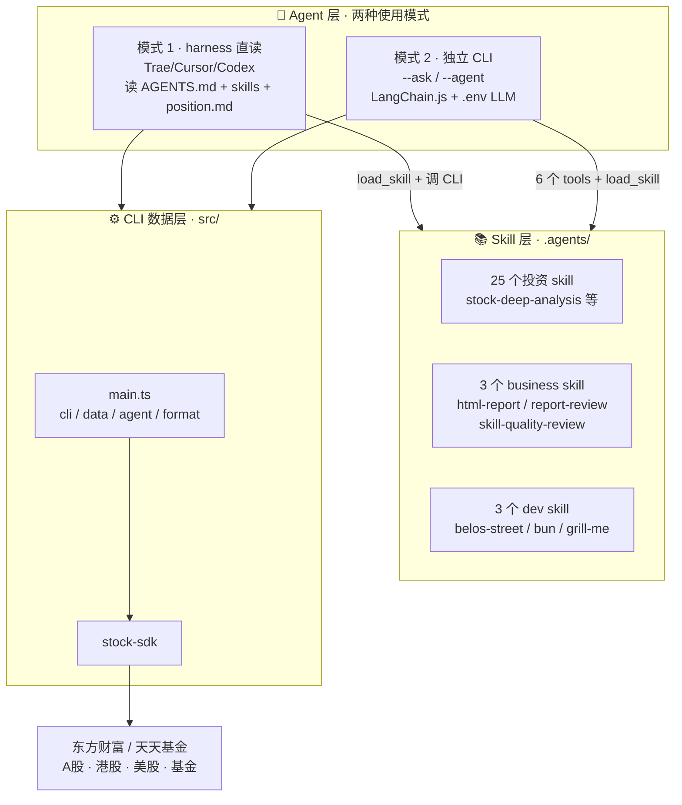

# Stock Analytics Agent - 股市投资分析助手

> 🚀 **V3.0 升级** - 2026年10月
> - **双模式**：harness 直读（模式1）+ LangChain.js 独立 CLI Agent（模式2）
> - **LLM 可配置**：`.env` 一键切换模型（DeepSeek / MoonShot 等 OpenAI 兼容端点）
> - **25 个投资 skill** + business/dev 技能，口径统一、可核验、含空方论点
> - **CLI 美化**：流式输出、彩色 Markdown、实时进度、回答溯源清单

## 项目简介

Stock Analytics Agent 是一个基于大语言模型（LLM）的股市投资分析智能体，专为个人投资者设计。它通过**模块化 Skill 架构** + **本地数据获取工具** + **AI Agent 双模式**，帮助投资者进行市场分析、资产配置和投资决策。

## 核心特点

- **🤖 双模式运行**：既可作为 harness 技能集被 IDE Agent 直读，也可作为独立 CLI Agent 对话
- **📊 多维度分析**：覆盖 A股、港股、美股、债券、ETF、基金等多个投资品种
- **🎯 智能持仓管理**：读取 `position.md` 自动调用对应分析技能
- **🔍 口径可核验**：估值分位/股息率/回撤统一口径标注，回答附「溯源清单」防幻觉
- **⚖️ 客观中立**：强制空方论点、估值陷阱检查，不给收益承诺
- **🛠 本地数据获取**：基于 stock-sdk 直接获取多市场实时行情
- **📈 长期投资导向**：专注长期稳健复利，不鼓励短期炒作

## 两种使用方式

> 按场景选择，可随时切换。两者共享同一套 skill 与数据层，逻辑零分叉。

| | 模式 1 · harness 直读 | 模式 2 · 独立 CLI Agent |
|---|---|---|
| **适用** | Trae / Cursor / Codex 等 IDE Agent | 终端独立对话，无需 IDE |
| **LLM** | 由 harness 提供，无需配置 | 需 `.env` 配置 API key / 模型 |
| **启动** | 把 `AGENTS.md` 给 Agent 即可 | `bun run main.ts --ask "..."` |
| **数据** | Agent 调 CLI 取数 | Agent 内置 6 个 tools 取数 |
| **场景** | 开发环境顺手分析 | 脚本化、多轮 REPL、管道集成 |

**模式 2 用法**：

```bash
# 单次提问
bun run main.ts --ask "帮我分析一下招商银行的基本面"

# 多轮对话（REPL，输入 exit 退出）
bun run main.ts --agent
```

## 系统架构



**分层说明**：
- **Agent 层**：决定「怎么用」——harness 直读 or LangChain.js 对话
- **Skill 层**：投资方法论（口径纪律、空方论点、估值框架），渐进式加载不爆上下文
- **CLI 数据层**：`main.ts` → `src/` → stock-sdk，两种模式共享，取实时行情/净值/股息/K线

## 投资理念

投资理念与风险偏好**由 `position.md` 按每位投资者自定义**，工具不预设立场——长期复利、成长、价值、红利、量化等不同风格均可适配。

## Skill 技能清单

### 投资分析 skill（25 个 · `.agents/skills/`）

#### 市场分析类（8）

| Skill | 功能 |
|-------|------|
| stock-analytics | 股市行情分析、资金流向、热点板块 |
| market-valuation | A股估值高低判断、加减仓时机 |
| macro-data-interpretation | CPI/PPI/PMI/GDP/社融解读 |
| macro-sector-transmission | 宏观变量→行业传导 |
| bond-yield-analysis | 债券利率走势、久期策略 |
| hk-stock-analysis | 港股市场、南向资金、AH 联动 |
| announcement-analysis | 公告与财报解读 |
| credit-analysis | 主体信用资质、违约概率评估 |

#### ETF / 基金类（8）

| Skill | 功能 |
|-------|------|
| dividend-low-vol-etf | 红利低波 50ETF（515450）加减仓 |
| broad-index-etf-analysis | 宽基 ETF（A500/沪深300/中证500） |
| a500-index-investment | A500 专属 PE 建仓、倒金字塔 |
| cash-flow-etf-analysis | 现金流 ETF、分红稳定性 |
| bond-fund-analysis | 债券基金、利率影响 |
| fund-screening | 按风险偏好筛选基金 |
| fund-comparison | 多只基金对比 |
| asset-allocation-rebalancing | 资产配置与再平衡 |

#### 个股 / 估值类（9）

| Skill | 功能 |
|-------|------|
| stock-deep-analysis | 个股深度分析（基本面/估值/财务） |
| stock-investment-logic | 券商风格个股研究 |
| valuation-framework | 估值方法与定价框架 |
| comparable-company-analysis | 可比公司 Comps 分析 |
| investment-memo | 一页纸投资备忘 |
| buffett-value-investing | 巴菲特四大原则价值投资 |
| investment-idea-generator | 量化筛选、主题扫描 |
| thematic-stock-picker | 按主题选股（AI/新能源等） |
| growth-stock-screener | 八维成长股筛选 |

### 业务技能（`.agents/business/`）

| Skill | 功能 |
|-------|------|
| html-report | HTML 报告生成封装 |
| report-review | 交付前多维审查 |
| skill-quality-review | Skill 质量/合规评审 |

### 开发技能（`.agents/dev/`）

| Skill | 功能 |
|-------|------|
| belos-street | 编码规范与工程流程 |
| bun | Bun 运行时 API |
| grill-me | 需求澄清 |

> 技能路由：投资问题搜 `skills/`；交付报告搜 `business/`；代码工程搜 `dev/`。详见 `AGENTS.md`。

## 使用场景

| 场景 | 触发条件 | 调用 Skill |
|------|---------|-----------|
| 市场分析 | A股整体行情、大盘走势 | stock-analytics |
| 市场估值 | A股估值高低、加仓时机 | market-valuation |
| 红利 ETF | 红利低波 515450 加减仓 | dividend-low-vol-etf |
| 宽基 ETF | A500/沪深300 估值 | broad-index-etf-analysis |
| A500 策略 | A500 建仓、倒金字塔 | a500-index-investment |
| 现金流 ETF | 现金流 ETF 策略 | cash-flow-etf-analysis |
| 债券基金 | 债券基金、利率影响 | bond-fund-analysis |
| 港股 | 港股/恒生医疗科技 ETF | hk-stock-analysis |
| 个股分析 | 个股基本面、估值 | stock-deep-analysis |
| 个股深度 | 深度投资逻辑研究 | stock-investment-logic |
| 价值投资 | 巴菲特理念、安全边际 | buffett-value-investing |
| 估值分析 | 估值方法、相对估值 | valuation-framework |
| 可比公司 | 估值对标、Comps | comparable-company-analysis |
| 投资备忘 | 一页纸报告 | investment-memo |
| 公告财报 | 公告、年报、业绩预告 | announcement-analysis |
| 信用分析 | 信用资质、违约概率 | credit-analysis |
| 债券利率 | 利率走势、久期 | bond-yield-analysis |
| 宏观数据 | CPI/PMI 等解读 | macro-data-interpretation |
| 宏观传导 | 宏观→行业传导 | macro-sector-transmission |
| 投资筛选 | 量化筛选、主题发现 | investment-idea-generator |
| 主题选股 | AI/新能源等主题 | thematic-stock-picker |
| 八维选股 | 成长股 8 维筛选 | growth-stock-screener |
| 基金筛选 | 按风险偏好选基金 | fund-screening |
| 基金对比 | 多基金对比 | fund-comparison |
| 资产配置 | 配置、再平衡、仓位 | asset-allocation-rebalancing |

## 快速开始

### 1. 环境自检与安装

```bash
# 安装 Bun 运行时（已有则跳过）
curl -fsSL https://bun.sh/install | bash
bun --version

# 安装依赖
bun install
```

### 2. 配置持仓

```bash
cp position.example.md position.md
# 编辑 position.md 填入你的持仓标的、目标占比、配置规则
```

> `position.md` 是个人持仓配置，已加入 `.gitignore` 不会提交。

### 3. 配置模型（仅模式 2 需要）

```bash
cp .env.example .env
# 编辑 .env 填入 LLM 配置
```

`.env` 内容（OpenAI 兼容端点均可）：

```env
OPENAI_API_KEY=sk-your-api-key
OPENAI_BASE_URL=https://api.deepseek.com   # DeepSeek / MoonShot 等
DEFAULT_MODEL=deepseek-chat                 # 模型名因供应商而异
# OPENAI_APPEND_V1=false                    # Azure/网关需保留原 URL 时关闭补 /v1
```

> 模式 1（harness）无需 `.env`，由 IDE Agent 自带 LLM。

### 4. 冒烟测试

```bash
bun run main.ts -s sh600519 --pretty   # 返回贵州茅台行情即环境就绪
```

### 5. 开始使用

- **模式 1**：把 `AGENTS.md` 交给 IDE Agent（或作为 system prompt），直接对话
- **模式 2**：`bun run main.ts --ask "今天A股表现怎么样？"` 或 `--agent` 进多轮对话

## CLI 工具

### 基本用法

```bash
bun run main.ts [options]
```

### 参数说明

| 参数 | 说明 | 示例 |
|------|------|------|
| `-s, --stocks` | A股/ETF/指数代码（逗号分隔，自动识别 sh/sz/hk） | `-s sh600519,sh600036` |
| `-f, --funds` | 基金代码（逗号分隔） | `-f 006493,006961` |
| `--hk` | 港股代码（逗号分隔） | `--hk 00700,01810` |
| `--us` | 美股代码（逗号分隔） | `--us AAPL,MSFT` |
| `--dividend` | 股息率查询 | `--dividend sh600941` |
| `--search` | 搜索股票/基金 | `--search 招商银行` |
| `--kline` | K线数据 | `--kline sh600519` |
| `--period` | K线周期：daily / weekly / monthly | `--kline sh600519 --period weekly` |
| `-o, --format` | 输出格式：json / table / csv | `-o table` |
| `--pretty` | 美化 JSON 输出 | `--pretty` |
| `--ask <question>` | 向 AI 助手提单个问题（模式2） | `--ask "分析招商银行"` |
| `--agent` | 进入 AI 多轮对话（模式2） | `--agent` |

> stdout 只输出数据，标题/提示走 stderr，可直接管道给 JSON 解析工具。

### 输出格式

**JSON**（默认）：
```json
[
  {
    "name": "贵州茅台",
    "code": "600519",
    "price": 1212.72,
    "change": -19.28,
    "change_percent": -1.57,
    "update_time": "2026/10/21"
  }
]
```

**Table**：
```
名称        代码     价格      涨跌    涨跌幅
贵州茅台    600519   1212.72   -19.28  -1.57%
```

### 支持的市场

- **A股**：sh600519（贵州茅台）、sh600036（招商银行）等
- **港股**：00700（腾讯控股）、01810（小米集团）等
- **美股**：AAPL（苹果）、MSFT（微软）等
- **基金**：006493、006961（南方中债）等
- **ETF**：sh515450（红利低波50ETF）等

## 使用示例

```bash
# 查询行情
bun run main.ts -s sh600941,sh600036 --pretty

# 查询股息率（含 yield_basis 口径标注）
bun run main.ts --dividend sh600941

# AI 助手单次提问（模式2）
bun run main.ts --ask "用巴菲特理念分析一下贵州茅台"
```

```
用户：今天我的持仓表现怎么样？
Agent：
1. 读取 position.md 了解持仓配置
2. 调 CLI 获取各持仓标的数据
3. 逐一加载对应 Skill 分析（含空方论点、口径标注）
4. 调 asset-allocation-rebalancing 给出再平衡建议
5. 输出报告 + 「📎 本次回答依据」溯源清单
```

## 项目结构

```
stock-analytics-agent/
├── main.ts                  # 薄入口：解析参数 → 分发
├── src/
│   ├── cli/                 # program/query/render（CLI 编排、渲染、spinner）
│   ├── data/                # sdk/dividend（数据获取层）
│   ├── agent/               # config/index/run/skills/tools/position/trace
│   ├── format.ts            # 输出格式化
│   ├── types.ts             # 集中类型定义
│   └── index.ts             # 统一导出
├── test/                    # bun test 用例
├── .agents/
│   ├── skills/              # 25 个投资 skill
│   ├── business/            # html-report / report-review / skill-quality-review
│   ├── dev/                 # belos-street / bun / grill-me
│   ├── rules/               # project_rules / memory
│   └── memory/decisions.md  # 决策日志
├── upgrade/v3.0/            # 3.0 升级归档（计划 todo + skills review 报告）
├── AGENTS.md                # Agent 配置（skill 路由、场景映射）
├── position.example.md      # 持仓配置模板
├── .env.example             # LLM 配置模板（模式2）
├── package.json
└── README.md
```

## 技术栈

- **运行时**：Bun
- **CLI 框架**：Commander
- **Agent 框架**：LangChain.js 1.0+（模式2）
- **数据 SDK**：[stock-sdk](https://github.com/chengzuopeng/stock-sdk)
- **CLI 美化**：ora（loading）+ marked / marked-terminal（彩色 Markdown）
- **工具链**：oxlint + oxcfmt + bun test + 类型检查
- **数据源**：东方财富 / 天天基金

## 致谢

| 项目 | 说明 | 链接 |
|------|------|------|
| **stock-sdk** | 零依赖股票数据 SDK，84 个命名空间方法 | [GitHub](https://github.com/chengzuopeng/stock-sdk) |
| **LangChain.js** | Agent 框架 | [docs.langchain.com](https://docs.langchain.com) |
| **天天基金 / 东方财富** | 数据源 | [eastmoney.com](https://www.eastmoney.com/) |

## 扩展开发

**添加新 skill**：
1. 在 `.agents/skills/` 下建目录，写 `SKILL.md`
2. 在 `AGENTS.md` 添加场景映射

**添加新数据源**：
1. 在 `src/data/` 建模块（参考 `sdk.ts`）
2. 在 `src/cli/program.ts` 加参数，`src/index.ts` 导出

## 注意事项

⚠️ **法律声明**
- 仅供个人学习和技术研究，禁止商业用途
- 数据来自公开第三方接口，归属权归各平台所有
- 不存储用户数据，不涉及账户登录

⚠️ **风险提示**
- 仅供学习参考，**不构成投资建议**
- 投资有风险，入市需谨慎
- 回答附「溯源清单」供核验，量化口径以文档标注为准

## 许可证

MIT License
