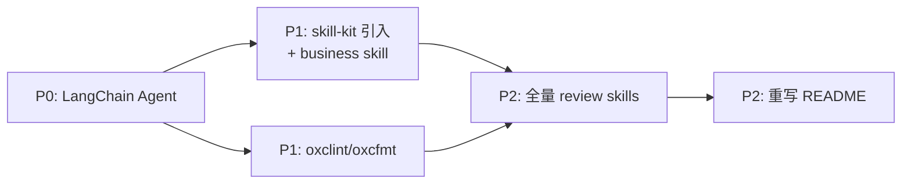

# 🚀 Stock Analytics Skill 3.0 升级计划

> 📅 创建日期：2026-10-16
> 📌 状态：Q1/Q2 均已拍板（LangChain.js / Bun + 双模式并存），可启动 P0 落码

## 📋 需求清单

| # | 需求 | 判定 | 优先级 |
| --- | --- | --- | --- |
| 1 | `.agents/business` 新增 skill，引入 skill-kit 优化代码质量 | ✅ 合理 | P1 |
| 2 | 引入 LangChain.js Agent，双模式（harness + 独立 CLI），用户配置模型即跑 | ✅ 合理（Q1/Q2 已拍板） | P0 |
| 3 | 工程化工具链换为 oxclint + oxcfmt | ✅ 合理 | P1 |
| 4 | 重写 README | ✅ 合理 | P2 |
| 5 | 全面 review `.agents/skills`（25 个） | ✅ 合理 | P2 |

## 🔓 开放问题

- ✅ **Q1 语言口径（已拍板 2026-10-16）**：使用 **LangChain.js 1.0+（TypeScript / Bun 技术栈）**，与现有代码栈一致。注意 skill-kit 的 `langchain` skill 为 Python 口径，仅可参考概念，API 以 LangChain.js 文档为准
- ✅ **Q2 Agent 定位（已拍板 2026-10-16）**：**双模式并存**，而非二选一
  - **模式 1 · harness 用法（保持现状）**：项目 download 到本地后，由 harness 工具（Codex、WorkBuddy 等）直接读取 `AGENTS.md` + `.agents/skills` 正常使用，现有"skill 提示词 + CLI 数据"工作流**保留不动**
  - **模式 2 · 独立 CLI 用法（新增）**：接入 langchainjs 的命令行入口，用户在 `.env` 配置自己的 LLM API key 即可直接命令行对话跑分析，不依赖任何 harness
  - **agent tools 构成**：现有 CLI 能力（行情、基金、股息、K线）+ skill 本身，统一封装为 agent 可调用的 tools

---

## ✅ TODO

### P0 · LangChain.js Agent（需求 #2）双模式

#### 模式 1 · harness 用法（保持现状，不许破坏）

- [ ] 盘点现有入口（`AGENTS.md`、`.agents/skills`、CLI）确保 agent 改造期间零破坏
- [ ] `AGENTS.md` 新增「环境自检与 bootstrap」章节，引导 harness agent 自行准备运行时：
  - 自检 `bun --version`，缺失时按引导安装（macOS：`brew install oven-sh/bun/bun`；通用：`curl -fsSL https://bun.sh/install | bash`）
  - 自检 `bun install` 依赖已就绪（`node_modules` 缺失时自动安装）
  - 自检 `position.md` 存在，缺失时引导从 `position.example.md` 复制后由用户填写
  - 各自检步骤给出可直接执行的命令 + 失败时的兜底提示
- [ ] 回归验证：harness 工具仍可读取项目并正常调用 skill + CLI

#### 模式 2 · 独立 CLI 用法（新增 langchainjs）

- [ ] 选定 LangChain.js 具体包与版本（`@langchain/core`、`@langchain/openai` 等 model 包 / LangGraph JS），确认 `createAgent` 接口形态
- [ ] 设计模型配置方案：`.env` 配置 LLM API key（支持 provider、model、api_key、base_url 由用户自行配置），加载优先级 `.env` > 环境变量
- [ ] 搭建 agent 骨架：模型加载 + 工具注册 + 对话式运行入口（新增 `agent` 命令，不覆盖现有 CLI 参数）
- [ ] 将现有 CLI 能力（行情、基金、股息、K线、搜索）封装为 agent tools
- [ ] 将 `.agents/skills` 封装为 agent 可调用的 tools（skill 文档作为工具描述/知识注入）
- [ ] 端到端验证：用户只改 `.env` 换一个模型配置即可跑通一次完整分析

#### 双模式一致性

- [ ] 两种模式共享同一数据层（`src/` CLI 能力），避免逻辑分叉
- [ ] README 说明两种使用方式的选择与切换

### P1 · skill-kit 引入 + business skill（需求 #1）

- [ ] 评估并从 skill-kit 引入相关 skill（候选：`belos-street` 编码规范、`bun` 最佳实践、`superpowers` 协作流程、`grill-me` 评审自查；排除 vue/react 等前端类）
- [ ] 按引入的规范审查 `src/`、`main.ts` 现有代码质量并优化
- [ ] `.agents/business` 新增 skill（内容待定义：候选方向如 分析报告生成、数据校验、口径标注 工具化）
- [ ] 与现有 `html-report`、`report-review` 两个 business skill 对齐模板与脚手架结构

### P1 · 工程化工具链（需求 #3）

- [ ] 引入 oxclint（替换/新增 lint），生成并调优 `.oxlintrc.json`
- [ ] 引入 oxcfmt（格式化），生成配置
- [ ] package.json 增加 `lint` / `format` /`format:check` 脚本
- [ ] 全量跑一次 lint + format，修复存量问题
- [ ] 与 Bun 工作流（`bun test`）串联验证

### P2 · 全量 review `.agents/skills`（需求 #5）

- [ ] 制定 review 清单（口径标注完整性、数据来源标注、空方论点、与 memory 教训对齐）
- [ ] 逐个 review 25 个 skill（市场分析类）
- [ ] 逐个 review 25 个 skill（ETF / 基金类）
- [ ] 逐个 review 25 个 skill（个股 / 估值类）
- [ ] 汇总改进项并分批落地修订
- [ ] 交叉验证修订后的 skill 输出口径一致性

### P2 · 重写 README（需求 #4）

- [ ] 更新架构图（3.0：agent 层 + skill 层 + CLI 数据层）
- [ ] 更新安装与快速开始（含模型配置说明）
- [ ] 更新 skill 清单（25 个 skill + business skills）
- [ ] 与 `agents.md`、`AGENTS.md` 目录引用保持一致

### 收尾

- [ ] 分批提交代码（新增 / 修改分开提交），**提交前需用户人工确认**
- [ ] 更新 `upgrade/` 下各阶段完成记录

---

## 📌 约束与注意事项

- 🔒 所有 git commit 必须经用户确认后执行
- 📐 量化口径标注规则沿用 project_memory 中的 hard constraints
- 🧩 技术选型优先可配置方案，避免硬编码
- ✅ 需求 #2 的 Q1/Q2 均已拍板（LangChain.js + 双模式），可启动 P0 落码
- 🔀 双模式硬约束：agent 改造不得破坏模式 1（harness 直读项目）的现有用法
