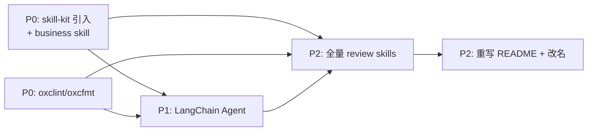

# 🚀 Stock Analytics Skill 3.0 升级计划

> 📅 创建日期：2026-10-16
> 📌 状态：Q1/Q2 均已拍板（LangChain.js / Bun + 双模式并存），可启动 P0 落码

## 📋 需求清单

| #   | 需求                                                                    | 判定                    | 优先级 |
| --- | ----------------------------------------------------------------------- | ----------------------- | ------ |
| 1   | `.agents/business` 新增 skill，引入 skill-kit 优化代码质量              | ✅ 合理                 | P0     |
| 2   | 引入 LangChain.js Agent，双模式（harness + 独立 CLI），用户配置模型即跑 | ✅ 合理（Q1/Q2 已拍板） | P1     |
| 3   | 工程化工具链换为 oxclint + oxcfmt                                       | ✅ 合理                 | P0     |
| 4   | 重写 README                                                             | ✅ 合理                 | P2     |
| 5   | 全面 review `.agents/skills`（25 个）                                   | ✅ 合理                 | P2     |

> 💡 优先级调整（2026-10-16）：规范与工具链先行，agent 编码时直接遵循，避免返工。P0 产出（编码规范、business skill、lint/format）是 P1 agent 开发的前置输入。

## 🔓 开放问题

- ✅ **Q1 语言口径（已拍板 2026-10-16）**：使用 **LangChain.js 1.0+（TypeScript / Bun 技术栈）**，与现有代码栈一致。注意 skill-kit 的 `langchain` skill 为 Python 口径，仅可参考概念，API 以 LangChain.js 文档为准
- ✅ **Q2 Agent 定位（已拍板 2026-10-16）**：**双模式并存**，而非二选一
  - **模式 1 · harness 用法（保持现状）**：项目 download 到本地后，由 harness 工具（Codex、WorkBuddy 等）直接读取 `AGENTS.md` + `.agents/skills` 正常使用，现有"skill 提示词 + CLI 数据"工作流**保留不动**
  - **模式 2 · 独立 CLI 用法（新增）**：接入 langchainjs 的命令行入口，用户在 `.env` 配置自己的 LLM API key 即可直接命令行对话跑分析，不依赖任何 harness
  - **agent tools 构成**：现有 CLI 能力（行情、基金、股息、K线）+ skill 本身，统一封装为 agent 可调用的 tools

---

## ✅ TODO

### P0 · skill-kit 引入 + business skill（需求 #1）

> ✅ 引入清单已拍板（2026-10-16）：`belos-street` + `bun` + `grill-me` 从 skill-kit 引入；`langchain` **不引入** skill-kit 的 Python 版，改为按需 WebFetch 官方文档 [llms.txt](https://docs.langchain.com/llms.txt) 核查 LangChain.js API；排除 superpowers（过重）/ rag / vibe-flow / 前端类

- [x] 从 skill-kit 复制 `belos-street`、`bun`、`grill-me` 到项目（放 `.agents/dev/`，与投资 skill 分开）✅ 2026-10-16，已统一 SKILL.md 命名
- [x] `agents.md` 新增「技能目录路由表」，三目录（skills/business/dev）按场景快速检索 ✅ 2026-10-16
- [x] 轻量采纳 ai-collab 体系：`.agents/rules/`（memory + project_rules）+ `.agents/memory/decisions.md`（已回填 D1-D6 决策），不引入 workflows/doc 分层/L6 闸门 ✅ 2026-10-16
- [x] 按 `belos-street` 规范审查 `src/`、`main.ts` 现有代码质量并优化 ✅ 2026-10-16，oxlint 全清（修复 eqeqeq×2、重复 import、switch 裸声明、no-shadow×3、catch 未用参数、丢失 cause×2），删除空目录 `src/formatter/`，lint/format/test/typecheck 全绿
- [x] ~~`.agents/business` 新增 skill~~ **结案不做**（2026-10-19）：三个候选方向已被现有能力覆盖——报告生成=`html-report`、数据校验=`report-review` D1、口径=`report-review` D2 + `project_rules` 口径纪律。再建 skill 属过度工程
- [x] ~~与 html-report、report-review 对齐模板~~ **结案不做**（2026-10-19）：不新增 skill 则对齐前提消失

### P0 · 工程化工具链（需求 #3）

- [x] 引入 oxlint（`.oxlintrc.json`，抄 belos-street 配置）✅ 2026-10-16
- [x] 引入 oxcfmt（`.oxfmtrc.jsonc`，**已排除 `**/*.md`** 避免研究文档被格式器 churn）✅ 2026-10-16
- [x] package.json 增加 `lint`/`lint:fix`/`format`/`format:check`/`typecheck` 脚本，typescript 移入 devDependencies ✅ 2026-10-16
- [x] 全量 lint + format，修复存量问题 ✅ 2026-10-16，还原了被误格式化的 README/position.example/strategy/watchlist
- [x] 与 Bun 工作流串联验证：`bun test` 7 pass、`typecheck` 通过（补 `@types/node` + tsconfig `types: ["bun","node"]`）✅ 2026-10-16

### P1 · LangChain.js Agent（需求 #2）双模式

> ⬆️ 前置依赖 P0：编码遵循 `belos-street` 规范，代码通过 oxclint/oxcfmt 校验

#### 模式 1 · harness 用法（保持现状，不许破坏）

- [x] 盘点现有入口（`AGENTS.md`、`.agents/skills`、CLI）确保 agent 改造期间零破坏 ✅ 2026-10-19，6 个入口全部完整
- [x] `AGENTS.md` 新增「环境自检与 bootstrap」章节，引导 harness agent 自行准备运行时 ✅ 2026-10-19：
  - 自检 `bun --version`，缺失时按引导安装（macOS：`brew install oven-sh/bun/bun`；通用：`curl -fsSL https://bun.sh/install | bash`）
  - 自检 `bun install` 依赖已就绪（`node_modules` 缺失时自动安装）
  - 自检 `position.md` 存在，缺失时引导从 `position.example.md` 复制后由用户填写
  - 各自检步骤给出可直接执行的命令 + 失败时的兜底提示
- [x] 回归验证：harness 工具仍可读取项目并正常调用 skill + CLI ✅ 2026-10-19，test 7 pass / lint 0 error / CLI 冒烟通过

#### 模式 2 · 独立 CLI 用法（新增 langchainjs）

- [x] 选定 LangChain.js 包：`langchain@1.5.18` + `@langchain/core` + `@langchain/openai` + `zod`，API 形态 `createAgent({ model, tools, systemPrompt })` + `tool()` ✅ 2026-10-19
- [x] 模型配置：`.env`（OPENAI_API_KEY / OPENAI_BASE_URL / DEFAULT_MODEL），`src/agent/config.ts` 读取 + 校验 + DeepSeek base_url 自动补 `/v1` ✅ 2026-10-19
- [x] agent 骨架：`src/agent/index.ts`（createAgent + 系统提示含口径纪律）、`src/agent/run.ts`（askOnce + chatLoop REPL）、`main.ts` 新增 `--ask`/`--agent` 命令（不覆盖现有参数）✅ 2026-10-19
- [x] CLI 能力封装为 tools：`src/agent/tools.ts` 5 个工具（行情/基金/股息/K线/搜索），复用 `src/` 数据层 ✅ 2026-10-19
- [x] `.agents/skills` 注入 agent：25 个 skill 渐进式披露（目录入系统提示 + `load_skill` 工具按需加载），避免全文爆上下文 ✅ 2026-10-19
- [x] 端到端验证：DeepSeek 实测跑通完整分析（工具调用、口径标注、月线验证、空方论点全部生效）✅ 2026-10-19

#### 双模式一致性

- [x] 两种模式共享同一数据层（`src/` CLI 能力），避免逻辑分叉 ✅ 2026-10-19，agent tools 直接调用 src/ 函数，零重复实现
- [ ] README 说明两种使用方式的选择与切换

### P2 · 全量 review `.agents/skills`（需求 #5）

- [ ] 制定 review 清单（口径标注完整性、数据来源标注、空方论点、与 memory 教训对齐）
- [ ] 逐个 review 25 个 skill（市场分析类）
- [ ] 逐个 review 25 个 skill（ETF / 基金类）
- [ ] 逐个 review 25 个 skill（个股 / 估值类）
- [ ] 汇总改进项并分批落地修订
- [ ] 交叉验证修订后的 skill 输出口径一致性

### P2 · 重写 README（需求 #4）

- [ ] 更新架构图（3.0：agent 层 + skill 层 + CLI 数据层）
- [ ] 更新安装与快速开始（含模型配置说明）
- [ ] 更新 skill 清单（25 个 skill + business skills）
- [ ] 与 `agents.md`、`AGENTS.md` 目录引用保持一致

### P2 · 项目改名 stock-analytics-agent（已拍板 2026-10-16）

- [ ] GitHub 仓库改名 `belos-street/stock-analytics-skill` → `belos-street/stock-analytics-agent`（GitHub 自动重定向旧 URL）
- [ ] 本地目录改名 `/Volumes/jiangzhi-ssd/code/personal/stock-analytics-skill` → `.../stock-analytics-agent`
- [ ] `package.json`：`name` 改为 `stock-analytics-agent`，bin 名评估是否同步（`stock-analytics` 可保留）
- [ ] 版本号口径统一：`package.json` `2.0.0` → `3.0.0`，`main.ts` 注释 "V2.0" → "V3.0"（review #6，并入改名时同步）
- [ ] 同步更新引用：`AGENTS.md`、README、`.git/config` remote、lockfile、文档内路径引用
- [ ] 改名后回归验证：`bun run main.ts`、`bun test`、harness 读取（模式 1）均正常

### ✅ 已落地功能复盘（2026-10-19，供以后回看）

> 以下是 3.0 P1 期间实际实现的功能点，超出原始 5 项需求的增量。

- **agent 双模式**：模式 1 harness 直读（零破坏）+ 模式 2 独立 CLI（`--ask` 单次 / `--agent` 多轮 REPL）
- **LLM 可配置**：`.env`（API_KEY / BASE_URL / MODEL）+ `.env.example` 模板，DeepSeek 端点自动补 `/v1`，换 `.env` 即换模型
- **6 个 agent tools**：行情、基金、股息、K线、搜索（复用 `src/` 数据层）+ `load_skill`
- **skill 渐进式注入**：25 个投资 skill 目录入系统提示 + `load_skill` 按需加载（避免全文爆上下文）
- **position.md 注入上下文**：agent 开口即知持仓与投资风格，无需每次复述
- **股息率口径标注**：`yield_basis` 字段标注"单期分红口径，非年度化"，防误当年化（呼应 memory 教训）
- **口径纪律进系统提示**：长窗口用 monthly、空方论点、不编造数据
- **AGENTS.md 环境自检 bootstrap**：agent 可自装 bun、自装依赖、自建 position.md
- **代码质量**：`any` 31→0、类型集中 `src/types.ts`、修 2 处实质 bug（死分支、null 类型遗漏）
- **工具链**：oxlint + oxcfmt（`**/*.md` 排除）、lint/format/typecheck 全绿
- **测试**：33 个测试（含 config/skills/position 离线单测 21 个）
- **决策记忆**：`.agents/memory/decisions.md` D1–D8 + `.agents/rules/`（project_rules、memory）
- **position.md 格式重构**：单一语义列、新增份额/成本价/操作规则/约束排除字段
- **记忆评估结论**：不做对话持久化（投资需实时数据、画像已在 position.md）；如需偏好沉淀走 position.md 扩展，不建独立记忆系统

### P2 · CLI 交互美化（体验优化）

- [ ] **修红字 bug**：`run.ts:88` chatLoop 用 `console.error` 输出回答（终端把 stderr 渲染成红色）→ 改 `console.log` 走 stdout，与 `--ask` 路径一致；提示/错误/状态仍留 stderr
- [ ] **loading 效果**：agent 思考/调工具期间无反馈，很生硬 → 引入 `ora` 显示 spinner（"思考中…" / "查询行情中…"），回答完成自动停止
- [ ] 回答文本美化（可选）：标题/表格/加粗渲染，或 chalk 给不同内容层次上色；控制在"清晰不花哨"
- [ ] 进度提示（可选）：工具调用时简报"正在查 600036 行情…"，让用户知道 agent 在干嘛
- [ ] 美化后回归验证：REPL 正常色输出、spinner 不残留、`--ask` 路径不受影响

> 📌 根因记录（2026-10-19）：「回答全是红色」不是缺美化，是 `console.error` 误用——stderr 被终端渲染成红色。回答属主输出应走 stdout。
> ✅ 顺带确认：多轮记忆测试 T1 通过（"刚才那只股票"正确接上招商银行），chatLoop 的 history 记忆路径正常。

### 收尾

- [ ] 分批提交代码（新增 / 修改分开提交），**提交前需用户人工确认**
- [ ] 更新 `upgrade/` 下各阶段完成记录

---

## 📌 约束与注意事项

- 🔒 所有 git commit 必须经用户确认后执行
- 📐 量化口径标注规则沿用 project_memory 中的 hard constraints
- 🧩 技术选型优先可配置方案，避免硬编码
- ✅ 需求 #2 的 Q1/Q2 均已拍板（LangChain.js + 双模式），可启动 P0 落码
- 🔀 双模式硬约束：agent 改造不得破坏模式 1（harness 直读项目）的现有用法
