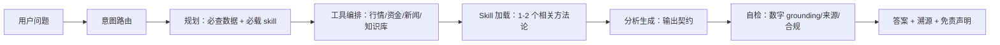

# Agent 回答质量升级方案（模式 2 · 独立 CLI）

> 日期：2026-10-25
> 状态：方案稿，未落码
> 范围：`src/agent/`、`.env`、`.agents/` 相关配置
> 目标：缩小模式 2（`bun run main.ts --agent`）与模式 1（harness）的回答质量差距
> 非目标：不改变模式 1 工作流；不引入重型多 agent / RAG 框架

---

## 0. 一句话结论

同一模型下，回答质量由四层决定：**模型档位、工具覆盖、规则与工作流、评估反馈**。当前模式 2 在这四层都弱于模式 1，所以差距是结构性的，不是换一句提示词能解决的。

最高杠杆的顺序：

1. 模型档位与路由
2. 行情 FullQuote + 复合工具 + WebSearch
3. 意图路由 + 输出契约 + 自检
4. Golden set + 日志反馈

---

## 1. 现状诊断

### 1.1 模式 1 vs 模式 2

| 维度 | 模式 1（harness） | 模式 2（CLI agent） | 影响 |
| --- | --- | --- | --- |
| 模型 | 由 harness / 用户选择，通常更强 | `.env` 当前 `DEFAULT_MODEL=deepseek-flash` | 深度、推理、长文能力 |
| 规则上下文 | `AGENTS.md` 约 28KB + 25 个 skill + rules/decisions | `src/agent/index.ts` 几十行 prompt + position + skill 目录 | 工作流、口径、边界 |
| 工具 | 取决于 harness，通常有 WebSearch、Wind/Tushare、浏览器、文件读取 | 6 个：行情 / 基金 / 股息 / K线 / 搜索 / load_skill | 数据广度 |
| 行情字段 | 多源可查 | `getQuotes` 走腾讯 CLI，缺 PE/PB/52 周高低 | 估值 / 回撤 / 量能 |
| Skill 加载 | 可读全文或按需读取 | `load_skill` 全文 10-25KB，无路由 | 上下文占用与命中率 |
| 会话 | harness 管理 | 全量 history，无摘要 | 长对话稳定性 |
| 评估 | 人工 | 无 golden set / 日志 | 无法持续优化 |

### 1.2 关键证据

- `src/agent/tools.ts` 只注册 6 个工具。
- `src/data/sdk.ts` 的 `getQuotes` 调用 stock-sdk CLI 的 `quote`（腾讯源），实测只返回 `price / change / changePercent / volume / amount / marketCap`。
- `sdk.quotes.cn` 实测返回 `pe=20.49`、`pb=6.64`、`peStatic`、`peDynamic`、`turnoverRate`、`volumeRatio`、`high52w`、`low52w` 等字段，但未接入 agent。
- `src/agent/index.ts` 没有读取 `.agents/rules/project_rules.md` 和 `.agents/memory/decisions.md`，D9-D11 的估值 / 股息率 / 仓位口径未进入模式 2。
- 单个 skill 约 10-25KB，全量加载会显著占用上下文。
- `position.md` 当前不存在，只有 `position.example.md`；持仓类问题无法个性化。
- `.env` 当前 `DEFAULT_MODEL=deepseek-flash`；`temperature=0.3`，无 `maxTokens` / `timeout` / `maxRetries` 显式配置。

---

## 2. 目标架构



---

## 3. 优化方案

### P0 · 先做（收益最大）

#### P0-1 模型档位与路由

**现状**

- `DEFAULT_MODEL=deepseek-flash`（低延迟档，具体能力以供应商为准）。
- `temperature=0.3`。
- 无 `maxTokens`、`timeout`、`maxRetries`。

**改动**

- `.env.example` 增加：
  - `DEEP_MODEL=`（可选；不填则回退 `DEFAULT_MODEL`）
  - `MAX_TOKENS=`
  - `REQUEST_TIMEOUT_MS=`
  - `MAX_RETRIES=`
- `src/agent/config.ts` 读取并校验。
- `src/agent/index.ts` 支持 `createInvestAgent({ tier: 'fast' | 'deep' })`。
- 路由规则（先规则后模型）：
  - fast：行情速览、持仓快照、单标的报价、基金净值
  - deep：个股深度、估值判断、宏观解读、投资备忘录、资产配置
- `temperature`：fast 0.2，deep 0.1。
- 无 `DEEP_MODEL` 时回退，不报错。

**涉及文件**

- `.env.example`
- `src/agent/config.ts`
- `src/agent/index.ts`
- `src/agent/run.ts`

**验收**

- 同一组 10 个深度问题，deep 档在完整性 / 准确性上不低于 fast 档。
- p95 延迟与成本在可接受范围；记录每次调用的 model / tokens / latency。
- 缺少 `DEEP_MODEL` 时行为与当前一致。

**风险**

- 成本 / 延迟上升；先用 10 题 A/B，再扩大。
- 模型名因供应商而异，需以端点实际可用名为准。

#### P0-2 行情工具升级为 FullQuote

**现状**

- `src/data/sdk.ts` 的 `getQuotes` 调 CLI 腾讯源，只有价格 / 涨跌幅 / 成交量 / 市值。
- 估值 / 回撤 / 量能类问题缺少 PE / PB / 52 周高低 / 换手 / 量比。

**改动**

- 新增 `getFullQuotes`，按市场调用 `sdk.quotes.cn/hk/us`。
- 字段映射：
  - `pe`、`pb`、`peStatic`、`peDynamic`
  - `turnoverRate`、`volumeRatio`
  - `high52w`、`low52w`、`high`、`low`、`prevClose`
  - `totalMarketCap`、`circulatingMarketCap`
- 统一输出元数据：`source`、`asOf`、`currency`、`unit`。
- `src/agent/tools.ts` 新增 `get_full_quote`（或替换 `get_stock_quote`，保留旧名做别名）。
- `src/types.ts` 扩展类型。

**涉及文件**

- `src/data/sdk.ts`
- `src/types.ts`
- `src/agent/tools.ts`

**验收**

- 贵州茅台返回 `pe / pb / 52w` 等字段；A / 港 / 美股各测 1 只。
- CLI 原有输出不回归。
- Agent 能回答“当前 PE/PB、52 周位置、换手率”并标注来源 / 基准日。

**风险**

- 不同市场字段形状不同，需逐市场测试。
- 数据源口径差异，输出必须带 source / asOf。

#### P0-3 复合工具：市场总览 + 持仓快照

**现状**

- Agent 需逐个调工具，容易漏项；持仓分析要分别查 A / 港 / 美 / 基金。

**改动**

- `get_market_overview`：
  - 指数：上证、深证、创业板、沪深300、中证500/1000（按需）
  - 涨跌家数、涨停 / 跌停数
  - 市场资金流
  - 北向资金摘要
  - 成交额
  - 返回 `asOf`、`source`、缺失项
- `get_portfolio_snapshot`：
  - 解析 `position.md` 表格（代码、查询参数、目标占比、当前占比、份额、成本价）
  - 批量拉行情 / 基金净值
  - 计算当前市值、实际占比、盈亏（有份额 / 成本时）
  - 缺失字段显式返回 `null` + 提示
- 新增 `src/agent/portfolio.ts` 或在 `src/agent/position.ts` 扩展。

**涉及文件**

- `src/agent/tools.ts`
- `src/agent/position.ts`
- 新增 `src/data/portfolio.ts`（可选）

**验收**

- 一次调用返回全部持仓；权重合计 100% 或显式标注现金 / 缺失。
- `position.md` 缺失时返回可执行提示，不编造持仓。
- 市场总览 1 次调用覆盖 5 类数据。

**风险**

- `position.md` 表格格式变化，解析需容错。
- 部分标的数据缺失，必须显式标注。

#### P0-4 WebSearch / WebFetch

**现状**

- 模式 2 无外部信息工具；新闻、政策、公告、财报电话会只能靠模型记忆。

**改动**

- 新增 `web_search` / `web_fetch` 工具。
- Provider 可配：`SEARCH_PROVIDER=tavily|serper|bing`，`SEARCH_API_KEY=`。
- 无 key 时的兜底：东方财富新闻 / 公告接口（如可稳定获取）。
- 返回结构：`title`、`url`、`snippet`、`publishedAt`、`source`。
- System prompt 要求：涉及新闻 / 政策 / 公告时先搜再答，引用 URL 与日期。

**涉及文件**

- 新增 `src/data/web.ts`
- `src/agent/tools.ts`
- `.env.example`
- `package.json`（如引入 provider SDK）

**验收**

- “贵州茅台 2026 三季报”能返回带 URL 的结果。
- `web_fetch` 能读取正文并转 markdown。
- 超时 / 限流 / 无 key 时有明确错误，不阻塞主流程。

**风险**

- API key / 成本；内容质量与版权；需要遵守数据源条款。

#### P0-5 把 SDK 已有能力接进来

**现状**

- stock-sdk 已支持资金流、北向、龙虎榜、融资融券、大宗交易、行业 / 概念板块、技术指标、基金档案 / 净值 / 排名、选股器；agent 只包了 6 个基础工具。

**改动（按需分批）**

- 市场 / 资金：`get_fund_flow`、`get_northbound`、`get_market_events`
- 事件：`get_dragon_tiger`、`get_margin`、`get_block_trade`
- 板块：`get_board_list`、`get_board_constituents`
- 技术：`get_technical_indicators`（MA / MACD / RSI / BOLL）
- 基金：`get_fund_profile`、`get_fund_nav`、`get_fund_rank`
- 选股：`screen_stocks`（`batch.cn` + `screener`）
- 备选：接 stock-sdk 自带 MCP server（`stock-sdk mcp`，`STOCK_SDK_MCP_TOOLS=full`），用 LangChain MCP 适配层接入，减少手写封装。

**约束**

- 工具总数控制在 10-15 个；同类合并为复合工具，避免模型选择困难。
- 每个工具必须有清晰的 `description`、参数 schema、单位、来源、as-of。

**验收**

- 每个工具单独 smoke test。
- 30 题评估中，相关意图的工具命中率 >= 90%。

**风险**

- 工具过多导致误选，需要路由和分组。
- 外部接口限流 / 变更，需要缓存与降级。

### P1 · 提示词 / 工作流（决定稳定性）

#### P1-1 意图路由

定义 8 类意图，并为每类固定“必查数据 + 必载 skill + 输出模板”：

| 意图 | 必查数据 | 必载 skill | 输出重点 |
| --- | --- | --- | --- |
| 行情速览 | 指数、涨跌家数、资金流、北向 | stock-analytics | 结论 + 数据表 |
| 持仓复盘 | portfolio snapshot、相关行情、估值 | asset-allocation-rebalancing + 标的 skill | 表现 + 偏离 + 操作边界 |
| 个股深度 | FullQuote、K线、估值分位、资金流、新闻 | stock-deep-analysis / stock-investment-logic | 逻辑 + 估值 + 风险 |
| 估值判断 | FullQuote、历史分位、同业 | valuation-framework | 分位 + 口径 + 情景 |
| 基金分析 | 净值、排名、持仓、回撤 | fund-comparison / fund-screening / bond-fund-analysis | 业绩 + 风险 + 适配 |
| 宏观解读 | 宏观数据、利率、市场 | macro-data-interpretation / macro-sector-transmission | 数据 + 传导 + 受益 / 受损 |
| 选股 | 筛选器、行业 / 概念、财务 | investment-idea-generator / growth-stock-screener | 候选 + 评分 + 风险 |
| 事件解读 | 公告、新闻、行情异动 | announcement-analysis | 事件 + 影响 + 证伪 |

实现方式：

- 规则优先（关键词 / 代码 / 意图词），不确定时用一次轻量 LLM 分类。
- 路由结果包含 `intent`、`requiredTools`、`skills`、`template`。
- 失败回退 `general`。

**涉及文件**

- 新增 `src/agent/router.ts`
- 新增 `src/agent/prompts.ts`
- `src/agent/index.ts`
- `src/agent/run.ts`

**验收**

- 30 题意图准确率 >= 90%。
- 必查工具召回率 >= 90%。
- 路由额外延迟 <= 1s。

#### P1-2 输出契约

统一结构：

1. 结论（1-3 句）
2. 关键数据表（数值 + 单位 + 来源 + 基准日 + 口径）
3. 支持论据
4. 空方论点 / 风险
5. 证伪条件
6. 配置参考（非买卖指令）
7. 免责声明

硬约束：

- 所有量化数字必须能在工具结果中找到；找不到就标“未获取”。
- 估值分位、回撤、股息率必须带口径与窗口。
- 不承诺收益、不预测概率、不给精确买卖点。
- 缺失数据显式标注，不补零、不编造。

**涉及文件**

- `src/agent/index.ts`
- `src/agent/prompts.ts`

**验收**

- 30 题中 >= 90% 包含来源 / 基准日。
- 无来源数字 = 0。
- 合规红线 = 0。

#### P1-3 运行时上下文

注入：

- 当前日期 / 星期
- 交易日状态（`sdk.calendar.marketStatus`）
- 上一交易日
- 各工具数据的 as-of

**涉及文件**

- `src/agent/index.ts`
- 新增 `src/agent/runtime.ts`

**验收**

- 周末 / 节假日提问时，“今天”指向最近交易日或明确说明休市。
- 数据基准日与工具输出一致。

#### P1-4 Skill 路由与规则蒸馏

**现状**

- 25 个 skill 目录全量注入；`load_skill` 加载全文 10-25KB。

**改动**

- 按意图选 1-2 个 skill，必要时只加载相关章节。
- 目录描述保持简短；新增关键词 / 意图映射。
- 把 `project_rules.md` 与 `decisions.md` 中的 D9-D11 蒸馏为 `rules_brief`，注入 system prompt：
  - 估值分位：近 10 年、月频、PE-TTM、负 PE 剔除、标基准日
  - 股息率：`yield_basis`，默认近 12 个月 DPS 年度化
  - 回撤 / 年内高低：monthly 完整周期
  - 仓位：单只个股 <= 10%、高风险 / 行业 ETF <= 5%、避免同风格重复暴露
  - 红线：不承诺收益 / 概率 / 精确买卖点

**涉及文件**

- `src/agent/skills.ts`
- `src/agent/index.ts`
- 可选新增 `.agents/rules/agent_brief.md`

**验收**

- 平均 skill token 消耗下降 >= 50%。
- 30 题 skill 选择准确率 >= 90%。
- 口径违纪 = 0。

#### P1-5 自检 / 复核

在最终回答前做一次轻量检查（只对 deep 意图开启）：

- 必查工具是否都调了？
- 回答中的数字是否都能在工具结果中找到？
- 是否标注来源 / 基准日 / 口径？
- 是否包含空方 / 风险 / 证伪？
- 是否触碰合规红线？
- 缺失数据是否标注？

实现：

- 确定性检查（工具 trace + 数字抽取）优先。
- 复杂问题再用一次 LLM verifier。
- 检查失败时：补充数据后重写，或明确标注“数据不足”。

**涉及文件**

- 新增 `src/agent/verify.ts`
- `src/agent/run.ts`

**验收**

- 30 题编造数字 = 0。
- 合规红线 = 0。
- deep 意图延迟增加 <= 20%。

### P2 · 评估、记忆与可靠性

#### P2-1 Golden set + 自动评估

- 新增 `eval/questions.jsonl`，30 题覆盖 8 类意图。
- 每题字段：`id`、`question`、`intent`、`requiredTools`、`keyFacts`、`expectedSections`、`notes`。
- 新增 `eval/run.ts`：非交互调用 agent，记录 answer + tool trace + model + latency。
- 评分：
  - 确定性：工具命中、关键数字、来源 / 基准日、合规红线
  - LLM-as-judge：准确性、完整性、可操作性、清晰度（1-5）
  - 人工抽检：每周 5 题
- `package.json` 增加 `eval` 脚本。
- 输出 `eval/results/YYYYMMDD.jsonl` + 汇总 md。

**验收**

- 有基线分数；每次改 prompt / tool 跑回归，分数不下降。
- bad case 可追溯到具体题目与工具 trace。

#### P2-2 日志与反馈

- `logs/qa.jsonl`（gitignored）：question、answer、toolCalls、model、tokens、latency、timestamp。
- REPL 增加 `/bad`、`/good` 命令，记录用户反馈。
- 每周回看 bad case，归类为：数据缺失、工具误选、口径错误、幻觉、表达问题。

#### P2-3 记忆与检索

- 长对话：保留最近 N 轮 + 摘要；超过阈值自动摘要。
- `search_knowledge`：检索 `reports/`、`watchlist/`、`.agents/memory/decisions.md`。
- 工具缓存：行情 30s、基金净值 5min、档案 / 排名 1h。
- 可选：把历史报告做成向量索引；先用关键词 / 全文检索，避免过度工程。

#### P2-4 可靠性

- 工具错误结构化返回：`{ error, code, hint, retryable }`，不直接 throw。
- 超时 / 重试 / 限流；批量查询并发控制。
- 数据源降级：主源失败时切备源，并在输出标注。
- 并行工具调用：独立数据源并行拉取。

---

## 4. 推荐落地顺序

### 阶段 1（P0，先跑通）

1. 模型档位 + `DEEP_MODEL` + 采样参数
2. FullQuote
3. 市场总览 + 持仓快照
4. WebSearch / WebFetch
5. 输出契约（最小版）

**交付**：同一组 10 题，模式 2 的答案在数据完整性、估值字段、来源标注上明显改善。

### 阶段 2（P1，稳定性）

1. 意图路由
2. Skill 路由 + 规则蒸馏
3. 自检
4. 运行时上下文

**交付**：30 题 golden set 基线；意图 / 工具命中率 >= 90%；口径违纪 = 0。

### 阶段 3（P2，持续优化）

1. SDK 深度工具（资金流 / 北向 / 龙虎榜 / 板块 / 基金 / 选股）
2. 日志 / 反馈
3. 记忆 / RAG / 缓存
4. 模型路由与成本调优

**交付**：每周评估报告；bad case 闭环；成本 / 延迟可控。

---

## 5. 验收指标

| 指标 | 目标 | 测量方式 |
| --- | --- | --- |
| 关键数字准确率 | >= 95% | 对照工具输出 / 主源 |
| 编造数字 | 0 | 数字 grounding 检查 |
| 来源 / 基准日覆盖 | >= 90% | 答案结构检查 |
| 口径违纪 | 0 | 规则检查 |
| 合规红线 | 0 | 规则检查 |
| 必查工具命中 | >= 90% | tool trace |
| 意图准确率 | >= 90% | golden set |
| p95 延迟 | 可接受 | 日志 |
| 用户 bad 率 | 下降 | 反馈 |

---

## 6. 风险与边界

1. **成本**：WebSearch、强模型、verifier 都会增加成本；先在 deep 意图开启。
2. **数据源**：外部接口可能限流 / 变更；必须有缓存、降级、错误提示。
3. **模型幻觉**：verifier 降低但不消除；关键数字必须可溯源。
4. **过度约束**：输出模板可能让简单问题变得啰嗦；按意图使用不同模板。
5. **工具膨胀**：工具太多会误选；控制在 10-15 个，同类合并。
6. **合规**：所有输出保留“仅供参考，不构成投资建议”；禁止收益承诺 / 概率 / 精确买卖点。
7. **配置**：`position.md` 是持仓分析的前提；缺失时只能给通用建议。

---

## 7. 附录

### 7.1 当前文件地图

| 文件 | 作用 |
| --- | --- |
| `src/agent/index.ts` | agent 骨架 + system prompt + 模型 |
| `src/agent/tools.ts` | 6 个工具 |
| `src/agent/run.ts` | 单次问答 + REPL + 流式 |
| `src/agent/skills.ts` | skill 目录 + 全文加载 |
| `src/agent/position.ts` | position.md 注入 |
| `src/agent/config.ts` | 模型配置 |
| `src/agent/trace.ts` | 工具调用追踪 |
| `src/data/sdk.ts` | 数据层（CLI 行情、K线、搜索） |
| `src/data/dividend.ts` | 股息率 |
| `.agents/skills/` | 25 个投资 skill |
| `.agents/rules/` | 项目规则 |
| `.agents/memory/decisions.md` | 决策日志 D1-D11 |

### 7.2 当前模型配置

- `OPENAI_BASE_URL=https://api.deepseek.com`
- `DEFAULT_MODEL=deepseek-flash`
- `OPENAI_APPEND_V1` 默认 true
- `temperature=0.3`
- 无 `maxTokens` / `timeout` / `maxRetries`

### 7.3 stock-sdk 可用能力（未接入 agent）

- 行情：`quotes.cn/hk/us`（FullQuote，含 PE/PB/52w/换手/量比）
- 资金流：`fundFlow.individual/market/rank/sectorRank`
- 北向：`northbound.summary/holdingRank/history/individual`
- 龙虎榜：`dragonTiger.*`
- 融资融券：`margin.*`
- 大宗交易：`blockTrade.*`
- 板块：`board.industry/concept`
- 技术指标：`kline.withIndicators`
- 基金：`fund.profile/navHistory/rankHistory/estimate`
- 选股 / 回测：`batch.cn` + `screener`
- 市场事件：`marketEvent.ztPool/stockChanges/boardChanges`
- 交易日历：`calendar.*`

### 7.4 快速验证命令

```bash
# 行情
bun run main.ts -s sh600519 --pretty

# FullQuote 字段验证
bun -e 'import { StockSDK } from "stock-sdk"; const s = new StockSDK(); console.log(JSON.stringify(await s.quotes.cn(["sh600519"]), null, 2))'

# Agent 单次问答
bun run main.ts --ask "分析一下贵州茅台当前估值"

# 评估（待实现）
bun run eval
```

### 7.5 后续决策记录

落地后按 `.agents/rules/memory.md` 追加决策，建议编号：

- D12 · 模式 2 模型档位与路由
- D13 · FullQuote 作为行情默认口径
- D14 · 工具分组与数量上限
- D15 · 评估集与回归门槛
