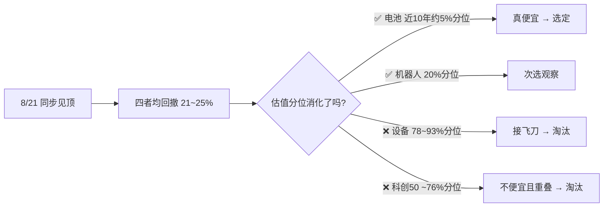

# 📡 高风险行业 ETF 候选对比调查报告

> **📅 调查日期**：2026-10-15（周四）
> **🎯 任务**：从 4 只高风险行业 ETF 中选出 1 支作为卫星仓位（硬顶 5% / ¥50,000）的区间定投标的
> **📍 状态**：✅ 已选定 **电池 ETF 159755** —— 不代表现在必须投，继续观察，等合适机会建仓

---

## 一、📋 候选清单与今日行情

| # | 标的 | 代码 | 今日涨跌 | 现价 | 规模 | 距 8/21 高点回撤 |
|---|------|------|---------|------|------|----------------|
| 1 | 机器人 ETF 华夏 | 562500 | -3.20% | 0.787 | ~147 亿 | -24.1% |
| 2 | 半导体设备 ETF 国泰 | 159516 | +0.33% | 0.601 | ~368 亿 | -24.8% |
| 3 | 科创 50 ETF 华夏 | 588000 | -1.37% | 1.438 | ~934 亿 | -24.3% |
| 4 | 电池 ETF 广发 | 159755 | -1.38% | 0.788 | ~60 亿 | -21.5% |

> 💡 四者 8 月下旬同步见顶，本轮调整幅度相近（-21%~-25%），但**估值消化程度差异巨大**——这是本次选筹的核心分水岭。

---

## 二、📊 多维对比矩阵

| 维度 | 562500 机器人 | 159516 半导体设备 | 588000 科创50 | 159755 电池 |
|---|---|---|---|---|
| 估值（PE-TTM） | 46–52 倍 | **117–122 倍** | 79–127 倍（各源口径不一） | **20–21 倍** |
| 估值分位 | 近 1 年 20% 分位 | 上市以来 78% / 近十年 93% | 历史约 76% | **近 1 年约 1.2% / 近 10 年约 5% / 基日以来约 15–20%** ⚠️ 口径见下 |
| 流动性 | ⭐⭐⭐ | ⭐⭐⭐⭐ | ⭐⭐⭐⭐⭐ | ⭐⭐⭐ |
| 核心逻辑 | 人形机器人量产元年，题材弹性最大 | 设备国产化 + ASML 零部件涨价 10% | 硬科技宽基，一篮子 | 储能爆发 + 全固态电池"十五五"规划 |
| 核心风险 | 纯主题，商业化不及预期即证伪 | 仍在"超级周期"溢价里，安全边际最薄 | 与恒生科技/纳指成长暴露重叠 | 产能过剩、价格战，周期底不确定 |
| 与现有组合重叠 | 中 | 高（科技成长） | 高（科技成长） | **低（新能源制造业）** |

> **⚠️ 分位口径说明（电池 ETF）**：不同数据源分位口径差异较大——近 1 年约 1.2%（最低）、近 10 年约 5%（4.5% 为新浪财经口径）、基日以来（2014 年底）约 15–20%。交叉验证：7 月 Wind 口径"近十年 17.17% 分位"对应 PE 25.56 倍，现 PE ≈20 倍反推近十年分位约 5% 上下，4.5% 大致可信但**低估程度在基日口径下没那么极端**。结论方向不变（四者中唯一便宜），但执行档位必须锁定同一口径（见第四节）。

### 🔑 核心结论：跌得多 ≠ 便宜

---

## 三、✅ 选定：电池 ETF 159755（推荐理由）

1. **💎 估值是四者中唯一真便宜的**——PE 20 倍出头、近 1 年约 1.2% / 近 10 年约 5% 分位（基日以来约 15–20%，见上文口径说明）；半导体设备跌了 25% 后 PE 分位仍在 80%+，回撤全是估值消化不足的泡沫
2. **🔗 与现有组合重叠最小**——高弹性桶规划中排了恒生科技 + 科创 50 + 纳指 100 三类成长暴露（其中科创 50、纳指 100 仅是待观察计划，尚未实际购买），电池属于新能源制造业，驱动因素不同
3. **📜 实打实的政策催化**——七部门《新型电池产业发展"十五五"规划》9/28 落地，首次从国家五年规划层面谋划新型电池产业；全固态电池获催化
4. **🛡️ 风险性质适合定投**——产能过剩是周期型风险（熬得过去），比机器人"故事证伪"型风险更适合区间定投慢慢摊
5. **🏆 同类中工具较优**——159755 规模居电池主题 ETF 前列（~60 亿，与 159796/561910 的 45–50 亿差距不大，排名随时点变动），但**流动性优势实打实**：今日成交 3.8 亿 vs 易方达 159175 日均约 0.16 亿

**次选**：机器人 562500（题材弹性最大 + 估值低位），若想搏更高弹性可小额并列观察，但先只投一支。

**淘汰**：
- ❌ **半导体设备 159516**：PE 117 倍、历史 80%+ 分位，现在定投等于在百倍 PE 里接飞刀
- ❌ **科创 50**：估值不便宜（~76% 分位），且与计划中的恒生科技 / 纳指 100 暴露重叠

### ⚖️ 空方论点（为求平衡，必须直面的反驳）

上述理由偏看多，以下是选电池 ETF 的反方证据，建仓前需逐条跟踪：

1. **⚠️ 周期股的"低 PE 陷阱"**：PE 20 倍可能不是便宜，而是**盈利周期顶部的表象**——如果锂电中游盈利还在下行通道，当前 E 是高估的，真实 PE 远高于 20。低 PE 常见于周期顶部，这是周期股估值的经典陷阱，本次选筹最需警惕的一点
2. **📉 碳酸锂价格仍在创新低**：10/15 电池级碳酸锂基准价 10.7 万元/吨，月内 -10.8%，正刷新年内低点——上游价格未企稳，说明产能出清远未结束，"周期底不确定"不是套话
3. **🏗️ 产能出清没有明确进度表**：价格战何时结束取决于落后产能退出速度，政策"十五五"规划管的是长期方向，救不了短期供给过剩
4. **🤖 对机器人不公平的对比**：本报告对机器人强调"故事证伪风险"，但它也有硬逻辑——摩根士丹利认为中国人形机器人领先、2025 年已小规模量产、产业链 2026 年加速爆发。作为次选它并非"次等资产"，只是题材型风险不适合本次的定投框架
5. **🧊 政策热 ≠ 立刻兑现**：全固态电池仍处产业化早期，规划落地到订单/量产落地之间可能有很长时滞

---

## 四、🎯 区间定投方案（仿恒生科技铁律风格）

**预算硬顶**：5% × 100 万 = **¥50,000**，投满即停，绝不追加
**估值锚（🔒 口径锁定）**：中证电池主题指数 **PE-TTM 的「近 10 年分位」**，固定使用 **理杏仁**（备份 etf.run）——⚠️ 每月查数必须用同一口径同一来源，切勿混用近 1 年 / 基日以来分位，否则档位会错位

| PE 分位（近 10 年口径） | 每月投入 | 说明 |
|---|---|---|
| **< 10%**（当前约 5%，已满足） | ¥2,000 | 打折区，加倍捡 |
| 10% – 30% | ¥1,000 | 标准定投 |
| 30% – 60% | ¥500 | 减速 |
| **> 60%** | ¥0，暂停 | 只持有不新增 |

**止盈铁律**：收益 > 50% **且** 分位 > 80% → 赎回 1/2；分位 > 90% 清仓。
**防心态条款**：不设止损、不看盘、下跌不停投。

### ⏳ 建仓触发（当前观察中，尚未开始）

- **基准口径锁定**：回撤以 **2026-08-21 盘中最高价 1.004** 为基准（不用收盘价口径，避免每月算错）
- 当前回撤 -21.5%（收盘 0.788 / 基准 1.004）
- **建仓触发线**：回撤 ≥ 25%，即 **159755 价格 ≤ 0.753** 时开第一枪（当前还差约 4.4%）
- 备选触发：中证电池主题指数 PE-TTM 跌破 18 倍，或固态电池产业出现明确订单/量产落地信号

---

## 五、⚠️ 待澄清：组合配置冲突

> position.md 高弹性桶（20%）规划了 4 个名额：恒生科技 5% + 恒生医疗 5% + 科创 50 5% + 纳指 100 5%。
> **现状**：实际已购只有恒生科技；恒生医疗、科创 50、纳指 100 均为**待观察、尚未买入**的计划名额。
> 若最终都买满，再加电池 ETF 5% 会把高弹性推到 **25%**，需二选一：

| 方案 | 做法 | 评价 |
|---|---|---|
| **挤占制（推荐）** | 电池 ETF 取代科创 50 的待观察名额 | 控制成长暴露重叠 |
| 扩容制 | 高弹性桶放宽到 25%，压缩固收或核心权益 | 需接受整体风险上升 |

由于科创 50 / 纳指 100 尚未实际建仓，挤占制几乎零成本——直接把观察名额换成电池 ETF 即可。

**⏸️ 待用户决策后更新 position.md。**

---

## 六、📅 跟踪清单

- [ ] 定口径：挤占制 vs 扩容制 → 更新 position.md（科创 50 / 纳指 100 目前仅为待观察名额，未实际购买）
- [ ] 每月查一次中证电池主题指数 PE-TTM **近 10 年分位**（理杏仁，口径锁定），对照档位
- [ ] 关注 159755 是否跌破 0.753（-25% 建仓线，基准 1.004）
- [ ] 跟踪全固态电池产业化进度（订单 / 量产 / 龙头财报）
- [ ] **空方跟踪**：碳酸锂价格何时止跌企稳、锂电中游盈利是否仍在下修（警惕低 PE 陷阱）
- [ ] 建仓后记录：日期 / 近 10 年分位 / 金额

---

*⚠️ 本文件为个人投资研究记录，不构成投资建议；市场有风险，投资需谨慎。*

**数据来源**：
- 行情：本地 CLI（`bun run main.ts`），2026-10-15 收盘
- 估值：每日经济新闻（机器人 PE 45.96/47.39）、证券之星（半导体设备 PE 130.87）、etf.run（931743 分位 78.02%、000688 分位 76.47%）
- 电池分位口径：新浪财经 2026-09-29（近 10 年 4.5%）、近 1 年约 1.2%、基日以来估算 15–20%（2026-04/05 分别约 24.6%/29% 后随下跌下移）；交叉验证 Wind 2026-07（近十年 17.17% 对应 PE 25.56）
- 碳酸锂：生意社电池级基准价 2026-10-15 为 10.7 万元/吨，月内 -10.8%，刷新年内低点
- 政策：七部门《新型电池产业发展"十五五"规划》（2026-09-28 印发）
