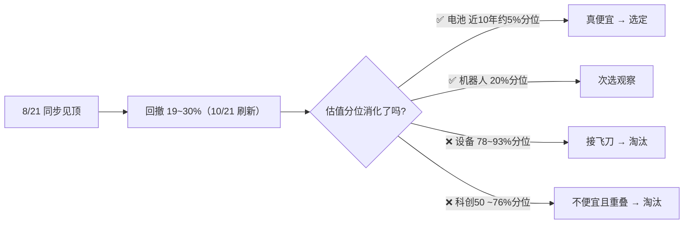

# 📡 高风险行业 ETF 候选对比调查报告

> **📅 调查日期**：2026-10-15（周四）
> **🎯 任务**：从 4 只高风险行业 ETF 中选出 1 支作为卫星仓位（硬顶 5% / ¥50,000）的区间定投标的
> **📍 状态**：✅ 已选定 **电池 ETF 159755** —— 不代表现在必须投，继续观察，等合适机会建仓
> **🔄 2026-10-21 观点更新**：宁德三季报 + 枧下窝复产后，长期逻辑保留，**短期看好程度下调一档**；0.753 触发线已被击穿但按新规加前置条件暂缓开枪，详见第五节

---

## 一、📋 候选清单与行情（2026-10-21 盘中刷新）

| # | 标的 | 代码 | 10/21 涨跌 | 现价 | 规模 | 距 8/21 高点回撤 |
|---|------|------|---------|------|------|----------------|
| 1 | 机器人 ETF 华夏 | 562500 | +0.12% | 0.843 | ~155 亿 | -18.7% |
| 2 | 半导体设备 ETF 国泰 | 159516 | -0.71% | 0.558 | ~349 亿 | -30.2% |
| 3 | 科创 50 ETF 华夏 | 588000 | +0.71% | 1.427 | ~1,052 亿 | -24.9% |
| 4 | 电池 ETF 广发 | 159755 | -3.10% | 0.751 | ~55 亿 | -25.2% |

> 💡 四者 8 月下旬同步见顶。**回撤基准口径锁定**：统一用 8/21 盘中最高价（月 K 核验：562500 1.037 / 159516 0.799 / 588000 1.899 / 159755 1.004）。10/21 刷新后**回撤已明显分化（-18.7%~-30.2%）**：机器人反弹最浅、半导体设备补跌最深、电池续创低点——但**估值消化程度差异巨大**仍是本次选筹的核心分水岭。
> 📌 10/15 原始快照（收盘）：0.787 / 0.601 / 1.438 / 0.788；规模为本地 CLI 市值字段 10/21 快照；估值数据（第二节）仍为 10/15 口径，待本月重查（见第七节）。

---

## 二、📊 多维对比矩阵

| 维度 | 562500 机器人 | 159516 半导体设备 | 588000 科创50 | 159755 电池 |
|---|---|---|---|---|
| 估值（PE-TTM） | 46–52 倍 | **117–122 倍** | 79–127 倍（各源口径不一） | **20–21 倍** |
| 估值分位 | 近 1 年 20% 分位 | 上市以来 78% / 近十年 93% | 历史约 76% | **近 1 年约 1.2% / 近 10 年约 5% / 基日以来约 15–20%** ⚠️ 口径见下 |
| 流动性 | ⭐⭐⭐ | ⭐⭐⭐⭐ | ⭐⭐⭐⭐⭐ | ⭐⭐⭐ |
| 核心逻辑 | 人形机器人量产元年，题材弹性最大 | 设备国产化 + ASML 零部件涨价 10% | 硬科技宽基，一篮子 | 储能爆发 + 全固态电池"十五五"规划 |
| 核心风险 | 纯主题，商业化不及预期即证伪 | 仍在"超级周期"溢价里，安全边际最薄 | 与恒生科技/纳指成长暴露重叠 | 产能过剩、价格战，周期底不确定 |
| 与现有组合重叠 | 中 | 高（科技成长） | 高（科技成长） | **低（新能源制造业）** |

> **⚠️ 分位口径说明（电池 ETF）**：不同数据源分位口径差异较大——近 1 年约 1.2%（最低）、近 10 年约 5%（4.5% 为新浪财经口径）、基日以来（2014 年底）约 15–20%。交叉验证：7 月 Wind 口径"近十年 17.17% 分位"对应 PE 25.56 倍，现 PE ≈20 倍反推近十年分位约 5% 上下，4.5% 大致可信但**低估程度在基日口径下没那么极端**。结论方向不变（四者中唯一便宜），但执行档位必须锁定同一口径（见第四节）。

### 🔑 核心结论：跌得多 ≠ 便宜

---

## 三、✅ 选定：电池 ETF 159755（推荐理由）

1. **💎 估值是四者中唯一真便宜的**——PE 20 倍出头、近 1 年约 1.2% / 近 10 年约 5% 分位（基日以来约 15–20%，见上文口径说明）；半导体设备跌了 25% 后 PE 分位仍在 80%+，回撤全是估值消化不足的泡沫
2. **🔗 与现有组合重叠最小**——高弹性桶规划中排了恒生科技 + 科创 50 + 纳指 100 三类成长暴露（其中科创 50、纳指 100 仅是待观察计划，尚未实际购买），电池属于新能源制造业，驱动因素不同
3. **📜 实打实的政策催化**——七部门《新型电池产业发展"十五五"规划》9/28 落地，首次从国家五年规划层面谋划新型电池产业；全固态电池获催化
4. **🛡️ 风险性质适合定投**——产能过剩是周期型风险（熬得过去），比机器人"故事证伪"型风险更适合区间定投慢慢摊
5. **🏆 同类中工具较优**——159755 规模居电池主题 ETF 前列（~60 亿，与 159796/561910 的 45–50 亿差距不大，排名随时点变动），但**流动性优势实打实**：10/15 当日成交 3.8 亿 vs 易方达 159175 日均约 0.16 亿

**次选**：机器人 562500（题材弹性最大 + 估值低位），若想搏更高弹性可小额并列观察，但先只投一支。

**淘汰**：
- ❌ **半导体设备 159516**：PE 117 倍、历史 80%+ 分位，现在定投等于在百倍 PE 里接飞刀
- ❌ **科创 50**：估值不便宜（~76% 分位），且与计划中的恒生科技 / 纳指 100 暴露重叠

### ⚖️ 空方论点（为求平衡，必须直面的反驳）

上述理由偏看多，以下是选电池 ETF 的反方证据，建仓前需逐条跟踪：

> ⚠️ **10/21 更新**：空方论点 ①②③ 已被宁德三季报与枧下窝复产事件**验证或强化**，逐条复核见第五节。

1. **⚠️ 周期股的"低 PE 陷阱"**：PE 20 倍可能不是便宜，而是**盈利周期顶部的表象**——如果锂电中游盈利还在下行通道，当前 E 是高估的，真实 PE 远高于 20。低 PE 常见于周期顶部，这是周期股估值的经典陷阱，本次选筹最需警惕的一点
2. **📉 碳酸锂价格仍在创新低**：10/15 电池级碳酸锂基准价 10.7 万元/吨，月内 -10.8%，正刷新年内低点——上游价格未企稳，说明产能出清远未结束，"周期底不确定"不是套话
3. **🏗️ 产能出清没有明确进度表**：价格战何时结束取决于落后产能退出速度，政策"十五五"规划管的是长期方向，救不了短期供给过剩
4. **🤖 对机器人不公平的对比**：本报告对机器人强调"故事证伪风险"，但它也有硬逻辑——摩根士丹利认为中国人形机器人领先、2025 年已小规模量产、产业链 2026 年加速爆发。作为次选它并非"次等资产"，只是题材型风险不适合本次的定投框架
5. **🧊 政策热 ≠ 立刻兑现**：全固态电池仍处产业化早期，规划落地到订单/量产落地之间可能有很长时滞

---

## 四、🎯 区间定投方案（仿恒生科技铁律风格）

**预算硬顶**：5% × 100 万 = **¥50,000**，投满即停，绝不追加
**估值锚（🔒 口径锁定）**：中证电池主题指数 **PE-TTM 的「近 10 年分位」**，固定使用 **理杏仁**（备份 etf.run）——⚠️ 每月查数必须用同一口径同一来源，切勿混用近 1 年 / 基日以来分位，否则档位会错位

| PE 分位（近 10 年口径） | 每月投入 | 说明 |
|---|---|---|
| **< 10%**（当前约 5%，已满足） | ¥2,000 | 打折区，加倍捡 |
| 10% – 30% | ¥1,000 | 标准定投 |
| 30% – 60% | ¥500 | 减速 |
| **> 60%** | ¥0，暂停 | 只持有不新增 |

**止盈铁律**：收益 > 50% **且** 分位 > 80% → 赎回 1/2；分位 > 90% 清仓。
**防心态条款**：不设止损、不看盘、下跌不停投。

### ⏳ 建仓触发（10/21 修订：价格线已击穿，加前置条件暂缓开枪）

- **基准口径锁定**：回撤以 **2026-08-21 盘中最高价 1.004** 为基准（不用收盘价口径，避免每月算错）
- **价格触发线（保留）**：回撤 ≥ 25%，即 **159755 价格 ≤ 0.753**
  - ⚠️ **10/21 已击穿**：全天位于触发线下方（盘中 0.749–0.751，回撤 -25.2%~-25.4%），但**按新规暂不开枪**（理由见下）
- **🔒 前置条件（10/21 新增，至少满足一项才开第一枪）**：
  1. 碳酸锂价格止跌企稳（不再创年内新低）
  2. 锂电中游盈利下修见底信号（宁德等龙头单位利润 / 毛利率环比不再恶化）
  3. 中证电池主题指数 PE-TTM 跌破 18 倍（原备选触发，保留）
  4. 固态电池产业出现明确订单/量产落地信号（原备选触发，保留）
- **修订理由**：价格触发线的前提"跌得够多 = 便宜"已被 10/21 事件削弱——本轮下跌是**盈利恶化驱动**而非单纯估值消化，仅凭回撤幅度开枪有接飞刀风险（详见第五节）
- **备选方案（若更看重执行纪律）**：按原计划开第一枪但金额减半（¥1,000），接受可能买在盈利下修半山腰——当前默认采用前置条件版，若倾向此方案请告知后改回

---

## 五、🔔 2026-10-21 事件复盘与观点更新（宁德三季报 + 枧下窝复产）

> **🎯 一句话结论**：赛道长期逻辑（储能爆发 + 全固态电池"十五五"规划）**未被证伪**，但"四者中唯一真便宜"的判断正被「低 PE 陷阱」验证，**短期看好程度下调一档**——核心问题从"跌够了没有"变成"**利润见底了没有**"。

### 📌 当天发生了什么

| 事件 | 内容 |
|---|---|
| 💥 宁德三季报（10/20 晚披露） | Q3 营收 1652 亿（+58.6%），但归母净利**环比 -5.77%**、低于市场预期；毛利率创 **2022Q4 以来新低**；单位利润 **82 元/kWh 创历史新低**；资产减值 17.12 亿（碳酸锂价格波动 + 高位库存） |
| 🏦 大行齐降级 | 摩根大通：港股 超配→中性、目标价 725→500 港元，理由是"担忧重心已从需求转向**盈利**，行业盈利能力恶化速度可能快于预期"；瑞银：目标价 820→730 港元（单位利润承压） |
| 📉 盘面 | 10/21 盘中宁德 A 股 **-10%~-11%**（11:17–11:39 三次快照 230.8–232.3），较年内高点 467.35 **腰斩**（约 -50%）；159755 **约 -3.1%**（0.749–0.751），较基准 1.004 回撤 **约 -25.2%**，**击穿 0.753 建仓触发线** |
| ⛏️ 枧下窝复产（微博热议事件本体） | 宜春政府层面推动、10 月下旬复产，满产状态每月新增碳酸锂供给 **5000–6000 吨**；叠加江特电机茜坑锂矿（理论 1.5 万吨 LCE/年）推进——供给端仍在**放量**，碳酸锂 5 月至今近腰斩、续创新低，10 万元/吨或难成支撑 |
| 🧾 新增政策变量（10/15 报告未覆盖） | 9/1 起锂离子蓄电池恢复征收**消费税**（过渡期税率 2%）+ 出口退税率 9%→6%；宁德 Q3 税金及附加 5.97→22.14 亿，结构性成本抬升 |

> 💡 微博"内卷、损人不利己"的叙事是噪音，但底层信号为真：连行业绝对龙头的单位利润都被卷到历史新低，这正是"周期底不确定"的实证。个股行为争议（压制上游锂矿）本身不影响指数级判断，影响判断的是**全行业单位利润新低 + 供给继续放量**这两个事实。

### 🔍 空方论点逐条复核（对照第三节）

| 空方 # | 10/21 后状态 |
|---|---|
| ① 低 PE 陷阱 | ⚠️ **正在兑现**——龙头单位利润历史新低、盈利环比下滑，E 端下修可能刚开始，"PE 20 倍很便宜"的成色明显下降 |
| ② 碳酸锂仍在创新低 | ⚠️ **强化**——枧下窝复产 + 茜坑锂矿是供给端新增利空，产能出清被推迟 |
| ③ 产能出清无进度表 | ⚠️ **强化**——政府在**推动复产**而非出清，出清进度表比 10/15 估计的更远 |
| ④ 机器人对比不公平 | 🔵 不变（次选定位不变） |
| ⑤ 政策热 ≠ 立刻兑现 | 🔵 不变 |

### 🎯 观点更新

- **长期（3–5 年）**：储能爆发 + 全固态电池"十五五"规划主线不变，赛道**不弃**，159755 保留为选定标的
- **短期（定投框架内）**：本轮是**盈利恶化驱动**而非单纯估值消化，盈利下修周期比 10/15 估计更长——"跌得多"的说服力下降，"利润见底"的确认变得更重要
- **执行**：建仓纪律修订为"价格线 + 前置条件"双闸（见第四节），本月按锁定口径重查估值分位以验证陷阱假设（见第七节）

---

## 六、⚠️ 待澄清：组合配置冲突

> position.md 高弹性桶（20%）规划了 4 个名额：恒生科技 5% + 恒生医疗 5% + 科创 50 5% + 纳指 100 5%。
> **现状**：实际已购只有恒生科技；恒生医疗、科创 50、纳指 100 均为**待观察、尚未买入**的计划名额。
> 若最终都买满，再加电池 ETF 5% 会把高弹性推到 **25%**，需二选一：

| 方案 | 做法 | 评价 |
|---|---|---|
| **挤占制（推荐）** | 电池 ETF 取代科创 50 的待观察名额 | 控制成长暴露重叠 |
| 扩容制 | 高弹性桶放宽到 25%，压缩固收或核心权益 | 需接受整体风险上升 |

由于科创 50 / 纳指 100 尚未实际建仓，挤占制几乎零成本——直接把观察名额换成电池 ETF 即可。

**⏸️ 待用户决策后更新 position.md。**

---

## 七、📅 跟踪清单

- [ ] 定口径：挤占制 vs 扩容制 → 更新 position.md（科创 50 / 纳指 100 目前仅为待观察名额，未实际购买）
- [x] ~~关注 159755 是否跌破 0.753~~ → **10/21 已击穿**（盘中 0.749），按修订规则等待前置条件，暂未开枪
- [ ] **本月重查**中证电池主题指数 PE-TTM **近 10 年分位**（理杏仁，口径锁定）——若盈利下修后分位不降反升，即是「低 PE 陷阱」的量化证据
- [ ] **空方跟踪（10/21 强化）**：碳酸锂价格何时止跌企稳（枧下窝满产节奏 / 茜坑锂矿投产进度）；宁德等龙头单位利润 / 毛利率何时环比止跌
- [ ] 跟踪消费税（2% 过渡期）+出口退税率下调对电池厂利润率的持续影响
- [ ] 跟踪全固态电池产业化进度（订单 / 量产 / 龙头财报）
- [ ] 跟踪车企"去宁德化"对产业链定价格局的后续影响
- [ ] 若考虑比亚迪（002594）：先做个股深度分析（`stock-deep-analysis`），并与电池 ETF 的重复暴露定口径后再谈仓位（见第八节 Q3）
- [ ] 建仓后记录：日期 / 近 10 年分位 / 金额 / 触发的前置条件

---

## 八、💬 2026-10-21 追问同步（买点 / 黄金坑 / BYD）

> 当日对话中三个高频追问的结论存档，与第四、五节纪律保持一致。**不构成投资建议，最终决策在用户。**

### Q1 ❓"电池 ETF 已经到买点了对吧？"——**不是，此判断需纠正**

**价格线满足 ≠ 买点。** 双闸状态（10/21 盘中）：

| 闸门 | 状态 |
|---|---|
| 🔔 价格线（≤0.753） | ✅ 已满足（盘中 0.751 / 最低 0.749） |
| 🔒 前置条件（4 选 1） | ❌ **0/4**：碳酸锂仍创新低、宁德单位利润刚创历史新低、PE<18x 未触发、固态订单未落地 |

这正是 10/21 修订要防的冲动：本轮下跌是盈利恶化驱动，"跌得多"这个买入理由本身已被削弱。**维持前置条件版（默认）**；若更看重执行纪律、想改用"减半试错"（¥1,000）备选方案，需明确改回第四节规则。

### Q2 ❓"离黄金坑还有多久？"——**时间不可预测，但坑有标志物**

不给时间预测（投资红线 + 诚实原则）。周期底不是"等到"的，是被信号**确认**的：

**🕳️ 黄金坑四标志物**（与第四节前置条件一致，任一确认即视为前置条件满足）：

- [ ] 碳酸锂不再创新低（枧下窝满产 + 茜坑投产的供给冲击被消化）
- [ ] 宁德等龙头单位利润 / 毛利率环比止跌（近期观察窗口：10 月底锂电中游三季报密集期）
- [ ] 中证电池 PE-TTM 近 10 年分位按锁定口径重新回落（而非因 E 下修反向抬升）
- [ ] 价格层面 PE < 18x

**📏 价位粗算标尺**（⚠️ 静态 E 假设，口径锚定 10/15 "PE 20–21x @ 0.788"，仅供参照）：

| 情形 | PE 18x 对应价格 | 较 10/21 现价 0.751 |
|---|---|---|
| E 不下修 | ≈ 0.68–0.71 | 再跌约 5–9% |
| E 下修 10%（可能性不低） | ≈ 0.61–0.64 | 再跌约 15–19% |

**⚠️ 悲观面**：产能出清被政府推动的复产**推迟**，锂价近腰斩仍未止跌——坑可能是 U 型甚至更长，而非 V 型。"黄金坑"三个字本身带诱导性，它预设了右侧很快会来。

### Q3 ❓"相比 ETF，看好 BYD 这个个股吗？"——**逻辑不同，不能互相替代**

比亚迪 10/21 现价 81.02（-1.91%），市值约 7,387 亿（本地 CLI）。

| | 看多 | 看空（强制对冲） |
|---|---|---|
| 📈 销量 | 9 月销量 46 万+ 创年内新高、连续四个月环比改善 | 9 月本土 28.4 万辆 **-13% 同比**，国内价格战未止 |
| 🌍 出海 | 海外 18.07 万辆、**+154% 同比**、占比 39%，独立 alpha | 欧美市场准入 / 关税风险（微博所述"禁入"挤压即此风险） |
| 💰 估值 | 2026E PE 约 20x（国投证券国际 H 股口径），目标价 103.6 港元"买入" | A/H 溢价约 20%；整车利润被上下游双向挤压（上半年国内数十家车企净利合计仅百亿级，第三方口径） |

**配置结论**：

1. 想表达"电池 / 储能链"观点 → **电池 ETF 更合适**：分散单票风险，赌的是中游制造周期修复 + 固态催化
2. BYD 的价值在**出海**——驱动逻辑（海外销量、关税、整车竞争）与电池 ETF（锂价、储能、产能出清）不完全同源，但同属新能源车大周期，**两者都买 = 高弹性桶重复暴露**，与"高弹性标的避免同一成长风格重复暴露"的项目纪律冲突
3. 若仍想配置 BYD：作为**独立个股课题**另行深度分析后再定仓位（单票同样建议 ≤5% 硬顶），当前阶段不建议用它替代电池 ETF

---

*⚠️ 本文件为个人投资研究记录，不构成投资建议；市场有风险，投资需谨慎；数据以官方披露为准。*

**数据来源**：
- 行情：本地 CLI（`bun run main.ts`），2026-10-15 收盘
- 估值：每日经济新闻（机器人 PE 45.96/47.39）、证券之星（半导体设备 PE 130.87）、etf.run（931743 分位 78.02%、000688 分位 76.47%）
- 电池分位口径：新浪财经 2026-09-29（近 10 年 4.5%）、近 1 年约 1.2%、基日以来估算 15–20%（2026-04/05 分别约 24.6%/29% 后随下跌下移）；交叉验证 Wind 2026-07（近十年 17.17% 对应 PE 25.56）
- 碳酸锂：生意社电池级基准价 2026-10-15 为 10.7 万元/吨，月内 -10.8%，刷新年内低点
- 政策：七部门《新型电池产业发展"十五五"规划》（2026-09-28 印发）

**10/21 更新数据来源**：
- 行情：本地 CLI（`bun run main.ts`），2026-10-21 盘中快照 11:17（159755 0.749 / 300750 231.63），11:27 复核漂移 ≤1%
- 宁德年内高点 467.35：2026-05 月 K **前复权**盘中高点（本地 CLI `--kline --period monthly` 核验；行情快报为不复权价，引用时勿混用）
- 宁德三季报：2026-10-20 披露（新浪财经、和讯网转述：营收 1652 亿、归母净利环比 -5.77%、单位利润 82 元/kWh、毛利率 2022Q4 以来新低、减值 17.12 亿）
- 大行评级：摩根大通（超配→中性，725→500 港元）、瑞银（820→730 港元），财联社 2026-10-21
- 枧下窝复产：北极星电力新闻网 2026-10-16（满产月增 5000–6000 吨）、证券时报（茜坑锂矿 300 万吨/年采矿、1.5 万吨 LCE/年）
- 税收政策：锂电消费税 2026-09-01 起恢复征收（过渡期 2%）、出口退税率 9%→6%（宁德三季报税金及附加交叉验证）
- 微博（何夕 2026-10-21）：仅作情绪面参考，不作为数据依据

**10/21 数据刷新与追问同步来源**：
- 行情刷新：本地 CLI 2026-10-21 11:39 快照（562500 0.843 / 159516 0.558 / 588000 1.427 / 159755 0.751 / 300750 232.33 / 002594 81.02）
- 回撤基准月 K 核验（前复权口径）：8/21 高点 562500 1.037 / 159516 0.799 / 588000 1.899（本地 CLI `--kline --period monthly`），159755 沿用锁定基准 1.004
- 比亚迪：2026 年 9 月产销快报（巨潮资讯 2026-10-08，出口 180,700 辆）、比亚迪官网（9 月销售 46 万+ 创年内新高）、东方财富 F10（9 月本土 28.4 万 -13% 同比 / 海外 18.0 万 +154% 同比、占 39%）、国投证券国际研报（2026-10-08，2026E PE 20x H 股口径、目标价 103.6 港元）
- "上半年国内数十家车企净利合计仅百亿级"：新浪财经 2026-09-21 转述，第三方口径，仅作定性参照
- 价位粗算：静态 E 假设下按 10/15 "PE 20–21x @ 0.788" 线性外推至 PE 18x，非预测值
